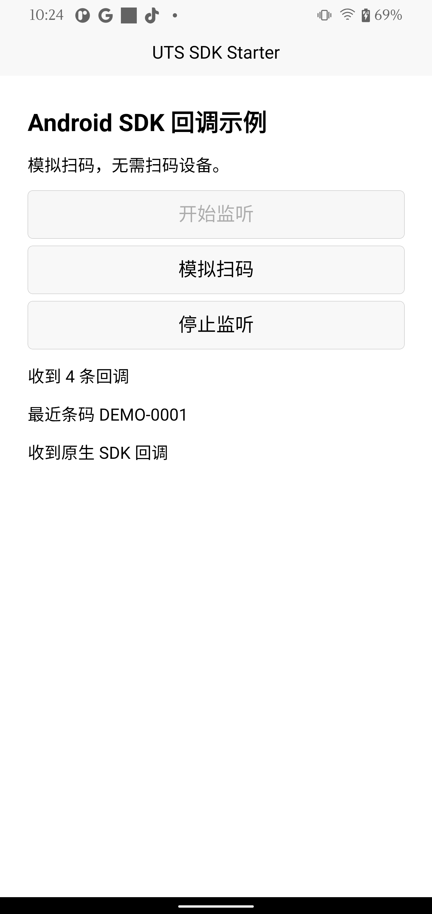

# uniapp-uts-sdk-starter

[简体中文](README.md) · [Android AAR build checks](https://github.com/LeeJUNhao791/uniapp-uts-sdk-starter/actions/workflows/android-aar.yml) · [Source release v0.2.1](https://github.com/LeeJUNhao791/uniapp-uts-sdk-starter/releases/tag/v0.2.1)

Connect an Android library (AAR) to a uni-app Vue 3 page through a UTS plugin. Build the sample AAR from source, then tap the demo buttons to see the Java callback deliver `DEMO-0001`. The runtime example uses a simulated barcode and requires no scanner, vendor SDK or backend. The Android app sets a minimum SDK of 23.



The screenshot shows the immediate callback in v0.1.1. The current sample also includes a delayed callback.

## Build the sample AAR

Install JDK 17 and Android SDK Platform 35. Set `JAVA_HOME` and `ANDROID_HOME` to their installation directories. From the repository root, run one of the following.

Windows PowerShell

```powershell
.\android-sdk\gradlew.bat -p android-sdk verifyDemoScanner stageDemoAar
```

macOS or Linux

```sh
./android-sdk/gradlew -p android-sdk verifyDemoScanner stageDemoAar
```

The test prints `PASS DemoScanner lifecycle and callbacks`. The build copies `demo-scanner-release.aar` into `demo/uni_modules/ljh-sdk-starter/utssdk/app-android/libs/`.

## Run the Android demo

Use HBuilderX (tested with 5.07), a DCloud account and an Android phone with USB debugging enabled.

1. Import `demo` in HBuilderX and sign in. In `manifest.json` → **Basic Configuration** (「基础配置」), obtain your own test AppID (「获取」 or 「重新获取」). Keep it in your local test copy. [DCloud AppID guide](https://uniapp.dcloud.net.cn/dev/app/introduction.html)
2. Open **Publish** (「发行」) → **Native App Cloud Packaging** (「原生 App 云打包」). Choose Android, enter a test package name, select the public test certificate and enable **Create custom debug base** (「制作自定义调试基座」). The resulting APK is `demo/unpackage/debug/android_debug.apk`. [DCloud Android packaging guide](https://uniapp.dcloud.net.cn/tutorial/run/run-app.html)
3. Connect the phone over USB and allow debugging. In HBuilderX, run `demo` on the Android device and select the **Custom base** (「自定义基座」) → **Local base** (「本地基座」). Rebuild the custom base whenever the AAR or native configuration changes. [Android quickstart in Chinese](docs/android-quickstart.md)

| On the phone | Expected result |
| --- | --- |
| Tap **Simulate scan** (「模拟扫码」) before starting the listener | Callback count stays at `0`. |
| Tap **Start listening** (「开始监听」), then tap **Simulate scan** twice | Count reaches `2` and the latest barcode is `DEMO-0001`. |
| Tap **Stop listening** (「停止监听」) and simulate another scan | Count stays at `2`. |
| Restart the listener and tap **Simulate delayed scan** (「延时模拟扫码」) | After about two seconds, the count increases by one. |
| Request another delayed scan, then stop listening or background the app before the result arrives | The pending result leaves the count unchanged. |

The recorded Pixel 4 XL test on Android 11 (API 30) covers immediate callbacks, stopping and restarting the listener, and cleanup when the app goes into the background. The Java test suite also exercises delayed callbacks.

## Replace the AAR

In a separate checkout, run the same Gradle wrapper command with the tasks `stageDemoAar :text-check:verifyTextCheck :text-check:assembleRelease`. Expect `PASS TextChecker success, empty input and UTF-16 length`. The output is `android-sdk/text-check/build/outputs/aar/text-check-release.aar`.

Replace `demo-scanner-release.aar` in the plugin's `libs/` directory with `text-check-release.aar`. Copy the three files under [`examples/text-check/demo`](examples/text-check/demo) to the matching paths under `demo`. Generate a new custom debug base. [AAR replacement guide with copy commands](docs/replace-aar.md)

In the replacement demo, tap **Validate text** (「校验文本」) with `hello` to see `长度 5` (length 5). Tap **Clear input** (「清空输入」), then validate again to see `错误 EMPTY_INPUT`. Both results were checked on a Pixel 4 XL for the v0.2.1 source release. [Device verification in the release notes](https://github.com/LeeJUNhao791/uniapp-uts-sdk-starter/releases/tag/v0.2.1)

When integrating your own Android SDK, use [`interface.uts`](demo/uni_modules/ljh-sdk-starter/utssdk/interface.uts) for the public types and [`app-android/index.uts`](demo/uni_modules/ljh-sdk-starter/utssdk/app-android/index.uts) for the native calls. The [Vue page](demo/pages/index/index.vue) shows how to import from `@/uni_modules/ljh-sdk-starter` and stop listening on page hide or unload. Use `@UTSJS.keepAlive` for a callback that can fire more than once. [DCloud UTS plugin guide](https://uniapp.dcloud.net.cn/plugin/uts-plugin.html)

## License

The example source is [MIT licensed](LICENSE). The Gradle Wrapper uses Apache-2.0. Follow the dependency's distribution terms when integrating your own SDK.
