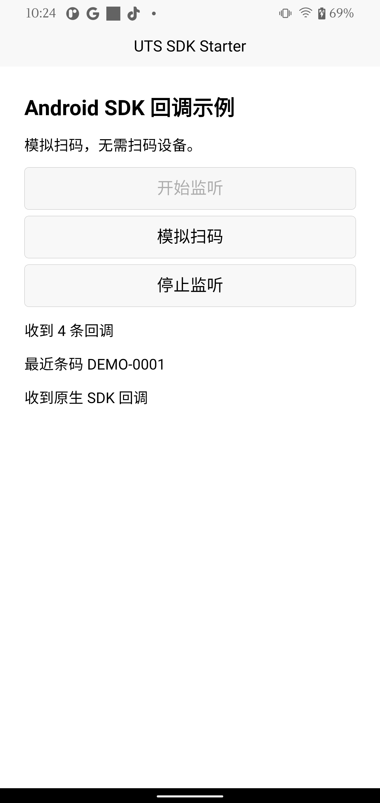

# uniapp-uts-sdk-starter

一个可从源码构建的 Android AAR、一个 uni-app UTS 插件和一个 Vue 3 示例页。点「模拟扫码」，页面收到原生 AAR 回调并显示 `DEMO-0001`。示例无需 PDA、厂商 SDK 或网络服务。

面向 **uni-app Vue 3 的 Android App**，最低 Android SDK 配置为 23。示例只生成模拟条码，适合用来验证自己的 AAR 如何接进 uni-app。

[Android 图文上手指南](docs/android-quickstart.md) · [示例 AAR 构建检查](https://github.com/LeeJUNhao791/uniapp-uts-sdk-starter/actions/workflows/android-aar.yml)



## 1. 构建和验证示例 AAR

安装 JDK 17、包含 Android SDK Platform 35 的 Android SDK，并让 `JAVA_HOME` 和 `ANDROID_HOME` 指向对应目录。从仓库根目录执行。

Windows PowerShell

```powershell
cd android-sdk
.\gradlew.bat verifyDemoScanner stageDemoAar
```

macOS / Linux

```sh
cd android-sdk
./gradlew verifyDemoScanner stageDemoAar
```

看到 `PASS DemoScanner lifecycle and callbacks` 后，`stageDemoAar` 会把 AAR 复制到
`demo/uni_modules/ljh-sdk-starter/utssdk/app-android/libs/`。再次执行同一命令会更新该文件。AAR 由仓库里的 Java 源码生成。

## 2. 在 Android App 中验收

按[图文上手指南](docs/android-quickstart.md)获取测试 AppID、制作 Android 自定义调试基座并运行到手机。基座运行后按下表验收。回调计数在当前页面内保留。

| 操作 | 预期结果 |
| --- | --- |
| 初次打开后直接点「模拟扫码」 | 计数保持 0 |
| 点「开始监听」，再点两次「模拟扫码」 | 计数达到 2，最近条码为 `DEMO-0001` |
| 点「停止监听」，再点「模拟扫码」 | 计数保持 2 |
| 重新开始监听，模拟扫码一次 | 计数达到 3 |
| 把 App 切到后台再回来，直接模拟扫码 | 计数保持 3，页面需要重新开始监听 |

## 3. 换成你的 AAR 或 JAR

- [API 类型](demo/uni_modules/ljh-sdk-starter/utssdk/interface.uts) 定义 uni-app 页面能看到的方法和回调类型。
- [Android UTS 桥](demo/uni_modules/ljh-sdk-starter/utssdk/app-android/index.uts) 导入 Java 类，实现 SDK 的回调接口。
- [演示页](demo/pages/index/index.vue) 调用插件，并在页面隐藏和卸载时停止监听。

把你的 AAR/JAR 放到插件的 `utssdk/app-android/libs/`。如果 SDK 有 Maven 坐标，优先在 `app-android/config.json` 的 `dependencies` 中使用 Maven 依赖。按 SDK 文档补所需的权限、资源、混淆规则和依赖，再替换 UTS 桥里的类名、类型和生命周期方法。 [DCloud Android 原生配置](https://uniapp.dcloud.net.cn/plugin/uts-plugin.html#android%E5%B9%B3%E5%8F%B0%E5%8E%9F%E7%94%9F%E9%85%8D%E7%BD%AE)

旧式插件通过 `uni.requireNativePlugin()` 获取模块，通常通过全局事件收结果。迁移后从 `uni_modules` 直接导入函数，原生结果经类型化回调送给页面。持续回调使用 `@UTSJS.keepAlive`。调用方应在一个页面会话里注册一次，并在离开时调用 `stopScan()`，释放原生 SDK 的监听器。 [DCloud 持续回调指南](https://uniapp.dcloud.net.cn/plugin/uts-plugin.html#uts%E6%8F%92%E4%BB%B6%E5%AF%BC%E5%87%BA%E6%96%B9%E6%B3%95%E4%B8%AD%E7%9A%84%E5%9B%9E%E8%B0%83%E5%87%BD%E6%95%B0%E5%8F%82%E6%95%B0%E5%A6%82%E4%BD%95%E6%94%AF%E6%8C%81%E6%8C%81%E7%BB%AD%E8%A7%A6%E5%8F%91)

如果能编译但手机收不到回调，依次核对 USB 调试、实际启动的基座、基座打包时间、AAR 是否是最新构建、Java 回调是否触发，以及页面是否已停止监听。

## 验证记录

- GitHub Actions：从干净检出编译示例 AAR、运行 Java 回调测试、核对插件目录中的 AAR 副本并检查公开 AppID 为空。
- Windows / JDK 17 / Android SDK 35：Gradle 构建、AAR 复制及 Java 监听生命周期测试通过。
- HBuilderX 5.07：本地编译器生成 uni-app Android 页面资源及 Kotlin 桥，并复制了同一份 AAR。
- 2026-11-16，Pixel 4 XL / Android 11（API 30）：使用 HBuilderX 5.07 自定义基座实测。未监听时回调为 0，开启后连续收到两次 `DEMO-0001`，停止后计数保持 2，重新监听后增至 3，切到后台再返回后模拟扫码仍保持 3。已核对手机上安装的 APK 与本地自定义基座 SHA-256 一致。

## 开源许可

示例源码使用 [MIT](LICENSE)。Gradle Wrapper 使用文件中标明的 Apache-2.0 许可。如果你接入自己的 SDK，请按该 SDK 的许可交付依赖。
