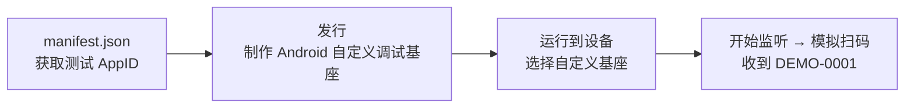
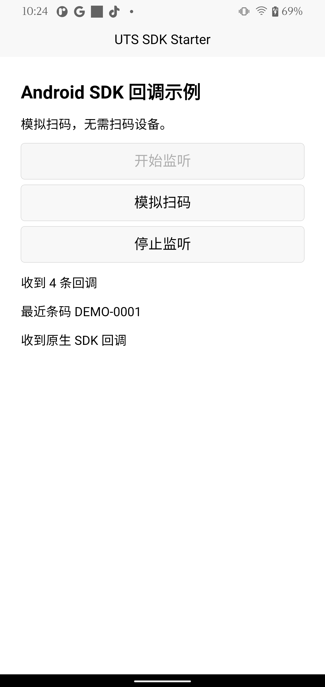

# 在 Android 手机上运行 UTS 回调示例

准备 HBuilderX（实测版本为 5.07）、DCloud 账号，以及一台已开启 USB 调试的 Android 手机。先按[仓库 README](../README.md#1-构建和验证示例-aar)构建示例 AAR，确认生成了 `demo/uni_modules/ljh-sdk-starter/utssdk/app-android/libs/demo-scanner-release.aar`。

## 1. 获取测试 AppID

登录 HBuilderX，导入仓库中的 `demo` 目录。打开 `manifest.json` 的「基础配置」，在「应用标识」处点击「重新获取」并保存。第一次打开时，按钮也可能显示「获取」。测试 AppID 仅填写在你的本地副本里。 [DCloud AppID 说明](https://uniapp.dcloud.net.cn/dev/app/introduction.html)

## 2. 制作 Android 自定义调试基座

在 HBuilderX 选中 `demo`，从「发行」进入「原生 App 云打包」（也可按 `Ctrl+U`）。选择 Android、填写独立的测试包名、选用公共测试证书，再勾选「制作自定义调试基座」并打包。成功后确认 `demo/unpackage/debug/android_debug.apk` 已生成。 [DCloud 云打包界面](https://uniapp.dcloud.net.cn/tutorial/run/run-app.html#%E4%BA%91%E6%89%93%E5%8C%85%E8%87%AA%E5%AE%9A%E5%9F%BA%E5%BA%A7)

## 3. 用自定义基座运行到手机

解锁手机，通过 USB 连接电脑并允许 USB 调试。在 HBuilderX 的「运行」菜单选择运行到 Android 设备，选中手机，并将基座设为「自定义基座」→「本地基座」。在手机上点「开始监听」和「模拟扫码」。页面应显示「收到 1 条回调」「最近条码 DEMO-0001」和「收到原生 SDK 回调」。 [DCloud 基座选择界面](https://uniapp.dcloud.net.cn/tutorial/run/run-app.html#%E4%BD%BF%E7%94%A8%E8%87%AA%E5%AE%9A%E4%B9%89%E5%9F%BA%E5%BA%A7%E8%BF%90%E8%A1%8C)

上图记录 v0.1.1 的即时回调。在 v0.2.0，按 [README 的验收步骤](../README.md#2-在-android-app-中验收)继续试「延时模拟扫码」。

页面能打开但收不到回调时，先核对运行时选择的基座。标准基座可以加载可热刷的页面资源，本示例的 Java AAR 随自定义基座打包，回调验收需要使用该自定义基座。更新 AAR 或修改原生配置后，重新制作并运行基座。 [DCloud 真机运行说明](https://uniapp.dcloud.net.cn/tutorial/run/run-app.html)
